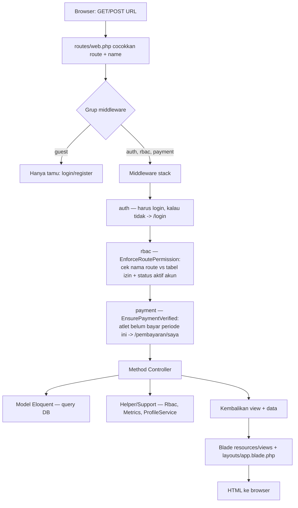

# Code Flow — Archer Monitor

Peta alur tiap menu/modul: **route (`routes/web.php`) → method controller → model/helper → view**.
Tujuannya supaya saat menelusuri atau mengubah fitur, kamu tahu persis file mana yang
terlibat dan urutannya.

> Stack: Laravel 10 · PHP 8.1 · MariaDB · Blade (server-rendered, bukan SPA — data
> dilempar dari controller ke view, tanpa AJAX). Semua angka profil dihitung di server.

## Daftar modul

| # | Modul / Menu | File |
|---|--------------|------|
| 1 | Autentikasi & Akun (login, register, logout, edit akun) | [01-auth-dan-akun.md](01-auth-dan-akun.md) |
| 2 | Dashboard | [02-dashboard.md](02-dashboard.md) |
| 3 | Atlet & data per-atlet (biodata, tes fisik/teknik, skor, beban, antropometri) | [03-atlet-dan-data.md](03-atlet-dan-data.md) |
| 4 | Buku Saku (shoot log) | [04-buku-saku.md](04-buku-saku.md) |
| 5 | Peralatan & Printout Beban | [05-peralatan-dan-beban.md](05-peralatan-dan-beban.md) |
| 6 | Head to Head | [06-head-to-head.md](06-head-to-head.md) |
| 7 | Laporan | [07-laporan.md](07-laporan.md) |
| 8 | Pembayaran | [08-pembayaran.md](08-pembayaran.md) |
| 9 | Pengguna | [09-pengguna.md](09-pengguna.md) |
| 10 | Metrik & Benchmark | [10-metrik-bm.md](10-metrik-bm.md) |
| 11 | Akses (RBAC): Role, Izin Route, Menu | [11-rbac.md](11-rbac.md) |

---

## Siklus satu request

### Urutan middleware (grup utama)
Didefinisikan di `routes/web.php`: `Route::middleware(['auth', 'rbac', 'payment'])`.
Alias dipetakan di `app/Http/Kernel.php`:

| Alias | Kelas | Tugas |
|-------|-------|-------|
| `auth` | `App\Http\Middleware\Authenticate` | Wajib login; kalau belum → redirect `login`. |
| `rbac` | `App\Http\Middleware\EnforceRoutePermission` | Cocokkan **nama route** dengan tabel izin RBAC (`App\Support\Rbac::routeAllowed`). Juga mengeluarkan akun yang `is_active = false`. **Deny-by-default**. |
| `payment` | `App\Http\Middleware\EnsurePaymentVerified` | Atlet tanpa pembayaran **verified** periode berjalan → dikunci ke `payment.my`. Staf tidak dikunci. |
| `role` | `App\Http\Middleware\EnsureRole` | Guard berbasis role (tersedia tapi tidak dipakai di route saat ini — akses diatur dari tabel RBAC). |

`logout` sengaja `->withoutMiddleware('rbac')` supaya user selalu bisa keluar.

---

## RBAC singkat (baca penuh di [11-rbac.md](11-rbac.md))

- Izin dinilai dari **NAMA route**, bukan URL. Pola pakai wildcard `Str::is`, mis. `athletes.*`, `payment.verify`.
- Sumber kebenaran runtime = **tabel DB** (`roles`, `route_permissions`, `menus`), di-seed dari `config/rbac.php` (`RbacSeeder`) dan di-cache. Ubah lewat menu **Akses (RBAC)** atau seed ulang.
- Kebijakan **deny-by-default**: route yang tidak terdaftar = ditolak. `'*'` = semua user login.
- `App\Support\Rbac` = otak RBAC: `routeAllowed()`, `menu()` (menu sidebar sesuai role), `isStaff()`.
- **Kepemilikan data** (atlet hanya datanya sendiri) dicek di controller lewat trait
  `App\Http\Controllers\Concerns\AuthorizesAthlete::authorizeView()`, bukan di middleware.

## Peta izin route (ringkas, dari `config/rbac.php`)

| Pola route | Role |
|------------|------|
| `rbac.*`, `metrics.*`, `users.*`, `payment.index/verify/reject`, `athletes.destroy` | admin |
| `athletes.index/create/store` | admin, coach |
| `athletes.edit/update` | admin, coach, athlete |
| `equipment.*` | admin, coach, athlete |
| `records.*`, `h2h.*`, `reports.*` | admin, coach |
| `dashboard.*`, `account.*`, `athletes.show`, `shoot-log.*`, `beban.*`, `payment.proof` | `*` (semua login) |
| `payment.my`, `payment.upload` | athlete |

## Lapisan file

- **Routes**: `routes/web.php`
- **Controllers**: `app/Http/Controllers/*`
- **Models (Eloquent)**: `app/Models/*` → tabel DB
- **Helper/Support**: `app/Support/{Rbac,Metrics,ProfileService}.php`
- **Middleware**: `app/Http/Middleware/*` (alias di `app/Http/Kernel.php`)
- **Views (Blade)**: `resources/views/*`, kerangka `resources/views/layouts/app.blade.php`
- **Config domain**: `config/archery.php` (metrik, benchmark, field form, dsb) & `config/rbac.php`
- **Seeder**: `database/seeders/{RbacSeeder,DemoSeeder,RoleUserSeeder}.php`
